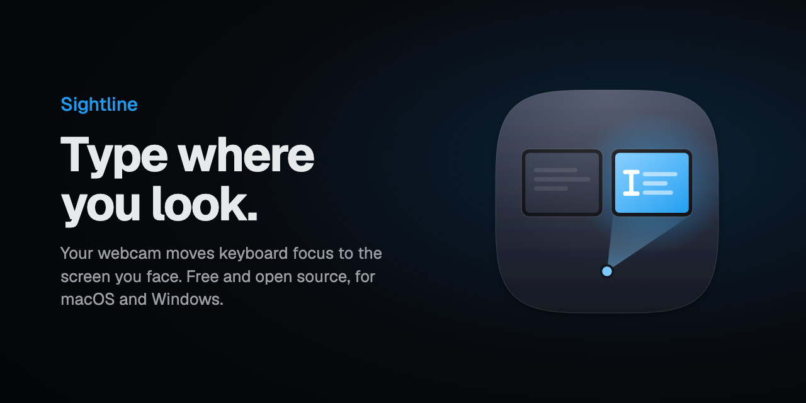
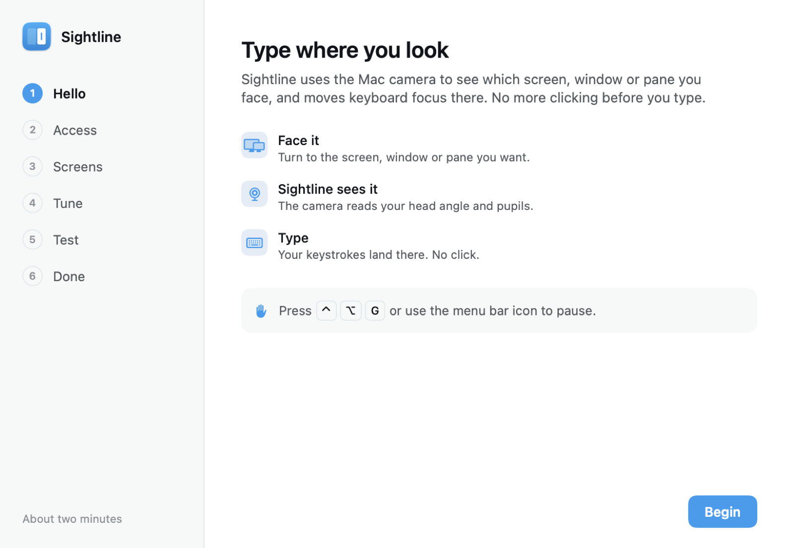
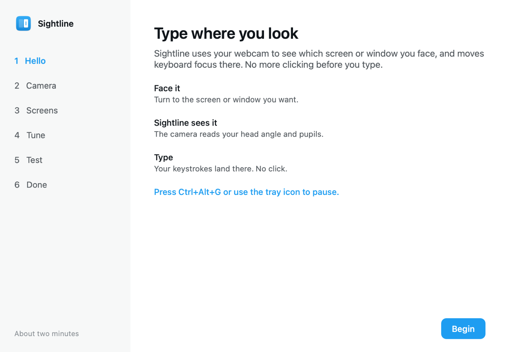
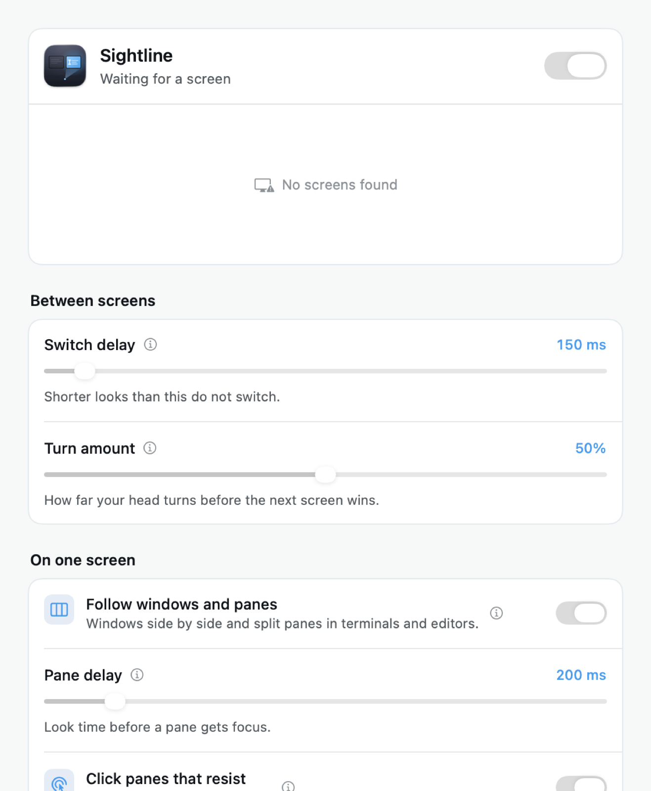
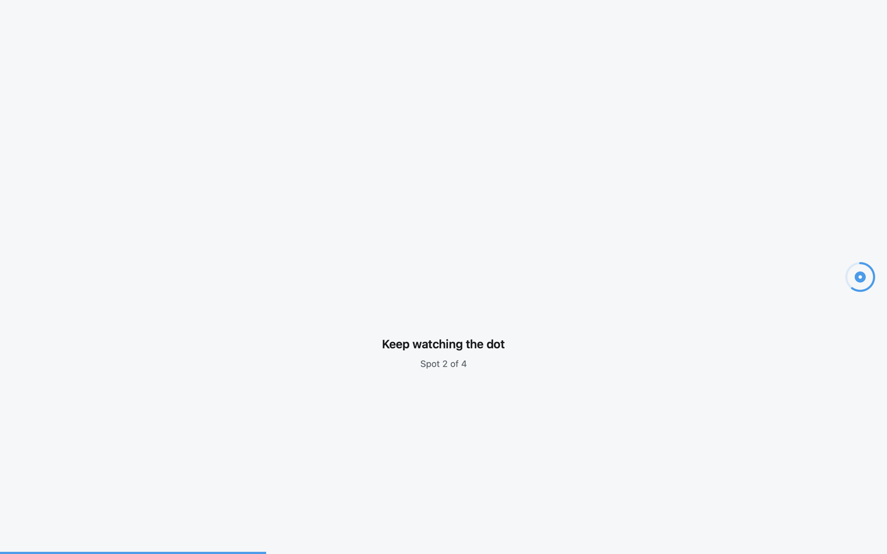

<div align="center">



<br>

[](https://github.com/abhayymishraa/sightline/releases/latest)
[](https://github.com/abhayymishraa/sightline/releases)


[](https://github.com/abhayymishraa/sightline/actions/workflows/ci.yml)
[](LICENSE)
[](https://abhayymishraa.github.io/sightline/)

**Sightline moves keyboard focus to the screen you look at.**<br>
Turn toward a monitor and start typing. The camera notices, and your keystrokes land there.

[Install](#install) · [Documentation](https://abhayymishraa.github.io/sightline/) · [How it works](docs/how-it-works.md) · [Troubleshooting](docs/troubleshooting.md) · [FAQ](#faq)

</div>

---

## Why

With two or more screens, you look at one window and type into another. You click first, every time. Sightline removes that click. It reads your head direction (and on supported cameras, your pupils) from the webcam, and gives focus to the screen, window or split pane you face.

- **No click before typing.** Turn your head; focus is already there.
- **Panes too.** On macOS, split panes in terminals and editors (iTerm2, Terminal, Ghostty, VS Code, Cursor, Xcode and more) follow your eyes.
- **Stays out of your way.** Focus holds while you type and while you use the mouse. A shortcut pauses it.
- **Learns as you work.** Every click is a hint about where you were looking, so accuracy improves on its own.
- **Private.** Frames are processed in memory, on your machine. Nothing is stored or sent. There is no account and no analytics.

## Install

### macOS 14 or later

```sh
curl -fsSL https://raw.githubusercontent.com/abhayymishraa/sightline/main/install.sh | bash
```

### Windows 10 or 11

Run this in PowerShell (no administrator rights needed):

```powershell
irm https://raw.githubusercontent.com/abhayymishraa/sightline/main/install.ps1 | iex
```

The same command updates an existing install. On first launch, a short **Getting Started** window asks for camera access, then has you look at a few dots on each screen (about 30 seconds per screen). After that, Sightline lives in the menu bar or the system tray.

<details>
<summary><b>Manual download and uninstall</b></summary>

<br>

Download `Sightline-macOS.zip` or `Sightline-Windows.zip` from the [latest release](https://github.com/abhayymishraa/sightline/releases/latest).

- **macOS:** unzip and move `Sightline.app` to Applications. The app is not notarized, so on first launch right-click it and choose **Open**.
- **Windows:** unzip anywhere and run `Sightline.exe`. If SmartScreen appears, choose **More info**, then **Run anyway**.

**Uninstall on macOS**

```sh
curl -fsSL https://raw.githubusercontent.com/abhayymishraa/sightline/main/install.sh | bash -s -- --uninstall
```

**Uninstall on Windows**

```powershell
& ([scriptblock]::Create((irm https://raw.githubusercontent.com/abhayymishraa/sightline/main/install.ps1))) -Uninstall
```

Both remove the app, its settings and its screen setup.

</details>

## Screenshots

<table>
<tr>
<td width="50%">
<picture>
  <source media="(prefers-color-scheme: dark)" srcset="docs/assets/macos-welcome-dark.png">
  
</picture>
<p align="center"><sub>Getting Started on macOS</sub></p>
</td>
<td width="50%">
<picture>
  <source media="(prefers-color-scheme: dark)" srcset="docs/assets/windows-welcome-dark.png">
  
</picture>
<p align="center"><sub>Getting Started on Windows</sub></p>
</td>
</tr>
<tr>
<td width="50%">
<picture>
  <source media="(prefers-color-scheme: dark)" srcset="docs/assets/macos-preferences-dark.png">
  
</picture>
<p align="center"><sub>Preferences, with a live map of the screen you face</sub></p>
</td>
<td width="50%">

<p align="center"><sub>Screen setup: follow the dot</sub></p>
</td>
</tr>
</table>

## How it works

1. **See.** The camera runs at 15 frames per second. Apple Vision (macOS) or MediaPipe (Windows) finds your face, its yaw and pitch, and where each pupil sits in the eye.
2. **Map.** During setup you look at dots near the edges each screen shares with its neighbours. Sightline records the head angles for each screen and fits a small regression from head and pupil features to a point on the screen.
3. **Decide.** Each frame, your head angle is placed on the line between the nearest setup spots of two screens. Past the boundary, and after a short delay, the other screen wins. Turning back needs a slightly bigger move, so focus does not flicker at the edge.
4. **Focus.** The window under your gaze on that screen comes forward and gets the keyboard. The pointer moves along only if it was on another screen.

Distance changes are corrected, outliers are dropped, and clicks quietly retrain the model. The full design is in [docs/how-it-works.md](docs/how-it-works.md).

## Requirements

| | macOS | Windows |
|---|---|---|
| System | macOS 14 Sonoma or later, Apple silicon or Intel | Windows 10 or 11, 64-bit |
| Camera | Built-in or external webcam that faces you | Built-in or external webcam that faces you |
| Access | Camera and Accessibility | Camera ("Let desktop apps access your camera") |
| Screens | One or more (pane focus works on one screen) | Two or more for screen switching; one is enough for window focus |

## FAQ

<details>
<summary><b>Is the camera image saved or uploaded?</b></summary>
<br>
No. Each frame is reduced to a few numbers (head angles, face size, pupil offsets) in memory and then dropped. Sightline makes no network requests, except the Windows app's one-time download of the open face model when you run it from source.
</details>

<details>
<summary><b>How accurate is it?</b></summary>
<br>
Picking the right screen is reliable, because a head turn toward another monitor is large. Picking a window or pane inside one screen works best with side-by-side layouts and a camera that faces you directly. Turn on <b>Show gaze dot</b> in Preferences to see the estimate.
</details>

<details>
<summary><b>I moved my monitors or my chair. Do I need to redo setup?</b></summary>
<br>
Small moves are learned from your clicks. After a bigger change, choose <b>Redo Setup…</b> from the menu bar or tray icon. Sightline also tells you when focus often misses on a screen.
</details>

<details>
<summary><b>macOS: the Accessibility switch is on, but nothing happens.</b></summary>
<br>
macOS ties the permission to the app's signature. Remove Sightline from the list with the minus button, then allow it again. See <a href="docs/troubleshooting.md">Troubleshooting</a>.
</details>

<details>
<summary><b>Why is the app not notarized or code-signed by a known publisher?</b></summary>
<br>
Sightline is a free, open-source project without a paid developer certificate. The installers fetch the official build from this repository's releases. You can also build it yourself in a minute; see <a href="docs/building.md">Building from source</a>.
</details>

<details>
<summary><b>How do I pause it?</b></summary>
<br>
Press <kbd>Ctrl</kbd> + <kbd>Option</kbd> + <kbd>G</kbd> on macOS or <kbd>Ctrl</kbd> + <kbd>Alt</kbd> + <kbd>G</kbd> on Windows, or use the menu bar or tray icon. You can change the shortcut in Preferences.
</details>

## Building from source

```sh
# macOS (needs the Xcode Command Line Tools)
macos/scripts/build-app.sh --install

# Windows (needs Python 3.12)
powershell -File windows\build.ps1
```

Details, the self-checks and the logo pipeline are in [docs/building.md](docs/building.md).

## Repository layout

| Folder | What is inside |
|---|---|
| [`macos/`](macos) | Swift app: SwiftUI, Apple Vision, Accessibility API. `GazeCore` holds the platform-free math. |
| [`windows/`](windows) | Python app: MediaPipe, OpenCV, Qt (PySide6), Win32 through `ctypes`. |
| [`logo/`](logo) | The icon and banner, drawn with React and SVG in [Remotion](https://www.remotion.dev). |
| [`docs/`](docs) | Guide, troubleshooting, architecture and build notes. |

## Contributing

Bug reports, ideas and pull requests are welcome. Read [CONTRIBUTING.md](CONTRIBUTING.md) first; it explains how to run the checks on both platforms.

## License

[MIT](LICENSE). Third-party components are listed in [THIRD_PARTY_NOTICES.md](THIRD_PARTY_NOTICES.md).
